# Iniciación a la virtualización

## Ubuntu en VirtualBox y contenedores con Docker

**Memoria**

Noviembre de 2026

---

# Iniciación a la virtualización: Ubuntu en VirtualBox y contenedores con Docker

## Resumen

Este informe documenta la instalación de un entorno de virtualización y contenedores. Se explica qué es la virtualización y en qué se diferencian una máquina virtual y un contenedor. Después se describe la instalación de Ubuntu 24.04 en VirtualBox y la instalación de Docker sobre él, incluyendo el error que apareció al instalar Docker Desktop desde `apt` y cómo se resolvió. Con Docker se despliegan dos contenedores: Nginx como servidor web y Tomcat como servidor de aplicaciones, que se comprueban con `docker ps` y desde el navegador. Por último se describen los requerimientos mínimos para implantar una aplicación web: estructura, hardware y software, red, configuración de los servidores, seguridad y mantenimiento. Las pruebas confirman que ambos servidores responden, con la particularidad de que Tomcat devuelve un error 404 en la raíz porque su imagen oficial no incluye aplicaciones.

## Palabras clave

Virtualización, VirtualBox, Ubuntu, Docker, contenedores, Nginx, Tomcat, servidor web, servidor de aplicaciones

## Índice

1. [Introducción](#1-introducción)
   1. [Qué es la virtualización](#11-qué-es-la-virtualización)
   2. [Máquinas virtuales y contenedores](#12-máquinas-virtuales-y-contenedores)
   3. [Objetivo](#13-objetivo)
2. [Instalación de Ubuntu en VirtualBox](#2-instalación-de-ubuntu-en-virtualbox)
3. [Instalación de Docker](#3-instalación-de-docker)
   1. [Preparación del sistema](#31-preparación-del-sistema)
   2. [Instalación de Docker Engine con el script oficial](#32-instalación-de-docker-engine-con-el-script-oficial)
   3. [Error al instalar Docker Desktop y solución](#33-error-al-instalar-docker-desktop-y-solución)
   4. [Verificación](#34-verificación)
4. [Contenedores de servidor web y de aplicaciones](#4-contenedores-de-servidor-web-y-de-aplicaciones)
   1. [Servidor web y servidor de aplicaciones](#41-servidor-web-y-servidor-de-aplicaciones)
   2. [Búsqueda de imágenes](#42-búsqueda-de-imágenes)
   3. [Descarga e inicio de los contenedores](#43-descarga-e-inicio-de-los-contenedores)
   4. [Verificación de los contenedores activos](#44-verificación-de-los-contenedores-activos)
   5. [Pruebas desde el navegador](#45-pruebas-desde-el-navegador)
5. [Requerimientos mínimos para implantar una aplicación web](#5-requerimientos-mínimos-para-implantar-una-aplicación-web)
   1. [Estructura y recursos de una aplicación web](#51-estructura-y-recursos-de-una-aplicación-web)
   2. [Hardware y software](#52-hardware-y-software)
   3. [Infraestructura de red](#53-infraestructura-de-red)
   4. [Configuración del servidor web y del servidor de aplicaciones](#54-configuración-del-servidor-web-y-del-servidor-de-aplicaciones)
   5. [Seguridad y mantenimiento](#55-seguridad-y-mantenimiento)
6. [Banco de pruebas](#6-banco-de-pruebas)
7. [Resultados, valoración y conclusiones](#7-resultados-valoración-y-conclusiones)
   1. [Resultados](#71-resultados)
   2. [Dificultades encontradas](#72-dificultades-encontradas)
   3. [Valoración personal](#73-valoración-personal)
   4. [Criterios de evaluación](#74-criterios-de-evaluación)
8. [Bibliografía](#8-bibliografía)
9. [Anexo: comandos de Docker usados](#9-anexo-comandos-de-docker-usados)

---

## 1. Introducción

### 1.1 Qué es la virtualización

La virtualización es una tecnología que permite ejecutar varios sistemas operativos o entornos de software independientes en una misma máquina física. Cada uno de esos entornos se llama máquina virtual (VM) y funciona como si fuera un equipo completo, con su propio sistema, sus programas y sus ajustes, aunque en realidad comparte el hardware real.

Los conceptos principales son:

| Concepto | Descripción |
| --- | --- |
| **Hipervisor** | Software que crea y gestiona las máquinas virtuales y les reparte los recursos. Ejemplos: VirtualBox, VMware o Hyper-V. |
| **Imagen ISO** | Archivo que contiene una copia exacta de un sistema operativo o de un instalador. Es lo que se «inserta» en la máquina virtual para instalar el sistema. |
| **Recursos virtualizados** | CPU, memoria RAM, almacenamiento y red que el hipervisor asigna a cada máquina virtual. |

### 1.2 Máquinas virtuales y contenedores

Un contenedor es una unidad de software que empaqueta el código de una aplicación junto con sus dependencias y su configuración, de modo que se ejecuta igual en cualquier sitio. La diferencia con una máquina virtual es que los contenedores comparten el núcleo (kernel) del sistema operativo del equipo en el que corren, mientras que cada máquina virtual lleva su propio sistema completo.

| | Máquina virtual | Contenedor |
| --- | --- | --- |
| **Qué incluye** | Sistema operativo completo y aplicaciones | Aplicación y sus dependencias |
| **Kernel** | Propio de cada máquina | Compartido con el equipo anfitrión |
| **Peso** | Gigabytes | Megabytes |
| **Arranque** | Minutos | Segundos |
| **Aislamiento** | Muy alto, a nivel de hardware virtual | Alto, a nivel de proceso |

Docker es la herramienta más usada para trabajar con contenedores. Sus ventajas principales son:

- **Portabilidad:** el mismo contenedor funciona en un portátil, en un servidor o en la nube.
- **Aislamiento:** cada aplicación corre separada de las demás con sus propias dependencias.
- **Escalabilidad:** es fácil lanzar más copias del mismo contenedor cuando aumenta la carga.
- **Rapidez de despliegue:** descargar y arrancar una aplicación lleva segundos.

### 1.3 Objetivo

El objetivo de la práctica es montar un entorno de virtualización completo, con una máquina virtual Ubuntu en VirtualBox y Docker dentro de ella, y usarlo para desplegar un servidor web (Nginx) y un servidor de aplicaciones (Tomcat) en contenedores. Además, se analizan los requerimientos necesarios para implantar una aplicación web en un entorno real.

---

## 2. Instalación de Ubuntu en VirtualBox

El proceso seguido para tener el sistema funcionando es el siguiente:

1. Se descarga la imagen ISO de Ubuntu 24.04 LTS desde la página oficial de Ubuntu.
2. En VirtualBox se crea una máquina virtual nueva y se le asignan los recursos recomendados en el enunciado:

   | Parámetro | Valor |
   | --- | --- |
   | Memoria RAM | 4096 MB |
   | Disco duro virtual | 50 GB como mínimo |
   | Tipo de red | NAT |

3. Se inicia la máquina con la ISO insertada y se completa el instalador de Ubuntu.
4. Una vez instalado el sistema, se instalan las Guest Additions desde el menú *Dispositivos* de VirtualBox. Mejoran la integración con el equipo anfitrión, por ejemplo con el ajuste automático de la resolución de pantalla.
5. Se comprueba que el escritorio arranca correctamente.

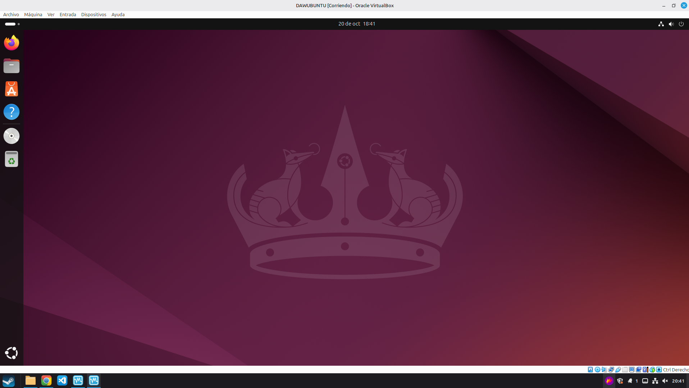

*Figura 1. Ubuntu instalado y funcionando en una máquina virtual de VirtualBox.*

---

## 3. Instalación de Docker

### 3.1 Preparación del sistema

Antes de instalar Docker se actualizan los repositorios y los paquetes del sistema, y se instalan las dependencias necesarias:

```bash
sudo apt update && sudo apt upgrade -y
sudo apt install ca-certificates curl gnupg -y
```

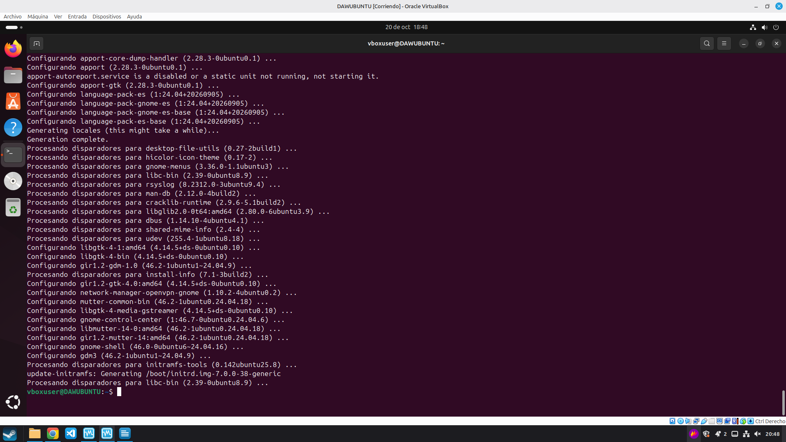

*Figura 2. Actualización de repositorios y paquetes del sistema.*

La actualización termina sin errores y el sistema vuelve al prompt. Después se instalan las dependencias:

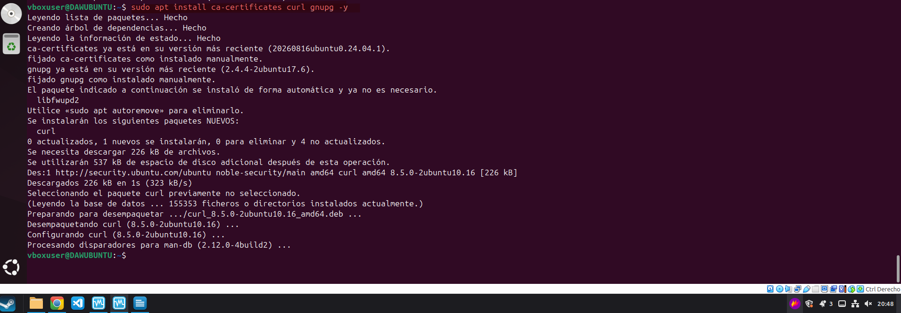

*Figura 3. Instalación de las dependencias.*

En la salida se ve que `ca-certificates` y `gnupg` ya estaban en su versión más reciente y que el único paquete nuevo es `curl`, que se descarga e instala. Sirve para descargar el script de instalación de Docker en el paso siguiente.

### 3.2 Instalación de Docker Engine con el script oficial

El enunciado indica añadir el repositorio de Docker con un script y a continuación instalar Docker Desktop:

```bash
curl -fsSL https://get.docker.com | sudo sh
sudo apt install docker-desktop -y
```

La primera orden descarga y ejecuta el script de instalación de Docker (`get.docker.com`). Este script instala **Docker Engine**, que es el servicio que ejecuta los contenedores, junto con sus componentes: el cliente, `containerd`, `runc` y `docker-init`. Al final muestra algunas recomendaciones, como la posibilidad de usar el modo *rootless* para ejecutar Docker sin privilegios de administrador.

### 3.3 Error al instalar Docker Desktop y solución

La segunda orden, `sudo apt install docker-desktop -y`, falló:

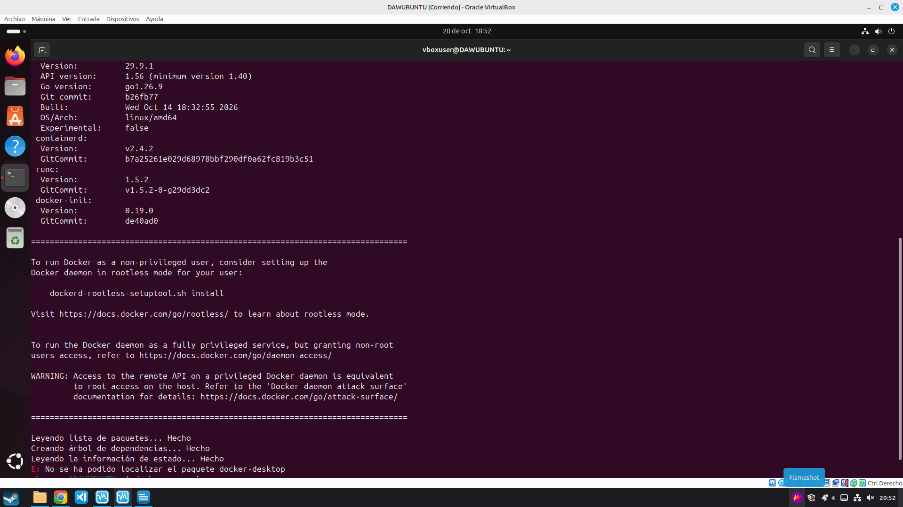

*Figura 4. Resultado del script de Docker y error al instalar `docker-desktop` con `apt`.*

El error que aparece es:

```text
E: No se ha podido localizar el paquete docker-desktop
```

Significa que `apt` no encuentra ningún paquete con ese nombre en los repositorios que tiene configurados. Docker Desktop no se distribuye por esa vía y hay que **descargar el paquete `.deb` desde la web oficial de Docker** e instalarlo desde el archivo local. Una vez descargado `docker-desktop-amd64.deb` en la carpeta personal, se instala así:

```bash
sudo apt install ./docker-desktop-amd64.deb
```

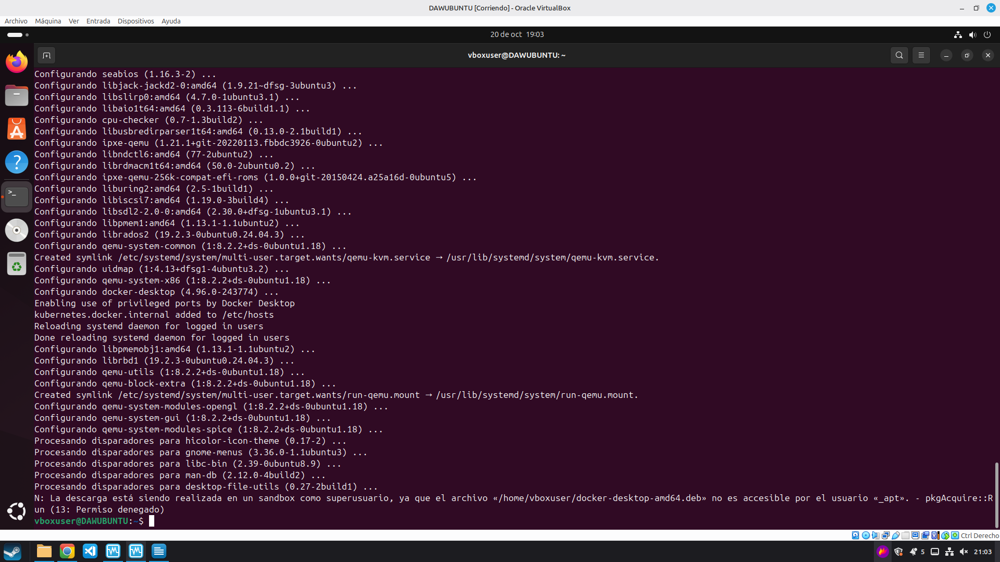

*Figura 5. Instalación de Docker Desktop desde el paquete `.deb`.*

En la salida se ve cómo se configura `docker-desktop` (versión 4.96.0). Con él se instalan varios paquetes de QEMU y KVM como dependencias, porque Docker Desktop para Linux ejecuta Docker dentro de una máquina virtual ligera. También se aprecian dos mensajes propios del instalador: la habilitación de puertos privilegiados y la adición de `kubernetes.docker.internal` al archivo `/etc/hosts`. Esta última línea es la que aparece en el archivo `hosts` de la [Figura 4 del documento de configuración de Apache](../../../Tema_3_Servidores-web/Ejercicios/Ejercicio_ACT_2/02_configuracion.md#15-resolución-del-nombre-en-local).

El último mensaje de la salida es un aviso, no un error: indica que la descarga se hizo como superusuario porque el archivo `.deb` no es accesible para el usuario `_apt`. Es habitual cuando se instala un paquete desde la carpeta personal y no impide la instalación.

### 3.4 Verificación

Para comprobar que Docker funciona se piden su versión y se ejecuta el contenedor de prueba:

```bash
docker --version
docker run hello-world
```

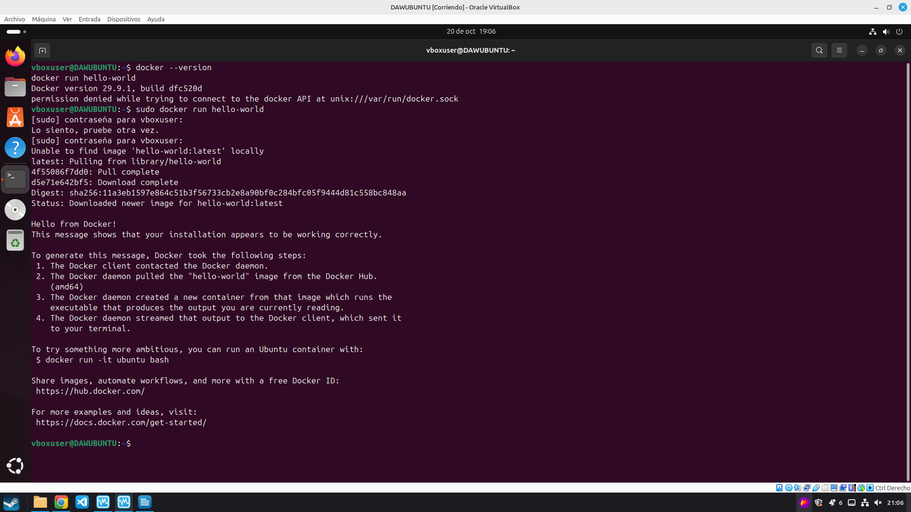

*Figura 6. Verificación de Docker: versión, error de permisos y ejecución de `hello-world` con `sudo`.*

El primer comando muestra la versión (`Docker version 29.9.1`). El segundo falla sin `sudo` con el error *permission denied while trying to connect to the docker API at unix:///var/run/docker.sock*: el usuario normal no tiene permiso para usar el socket de Docker. Repetido con `sudo`, el comando funciona: Docker no encuentra la imagen `hello-world` en local, la descarga del repositorio público y crea el contenedor, que imprime el mensaje *Hello from Docker!* y confirma que la instalación es correcta.

La alternativa a usar `sudo` en cada comando sería añadir el usuario al grupo `docker`. Aquí se ha mantenido `sudo`, así que todos los comandos siguientes lo llevan.

---

## 4. Contenedores de servidor web y de aplicaciones

### 4.1 Servidor web y servidor de aplicaciones

Para la práctica se despliegan dos tipos de servidores:

| Tipo | Función | Ejemplo usado |
| --- | --- | --- |
| **Servidor web** | Atiende peticiones HTTP/HTTPS y sirve contenido, normalmente estático. También puede actuar como proxy inverso. | Nginx |
| **Servidor de aplicaciones** | Ejecuta la lógica de negocio de una aplicación, en este caso aplicaciones Java. | Tomcat |

### 4.2 Búsqueda de imágenes

Una imagen es la plantilla a partir de la cual se crea un contenedor. Con `docker search` se buscan las disponibles en Docker Hub:

```bash
sudo docker search nginx
sudo docker search tomcat
```

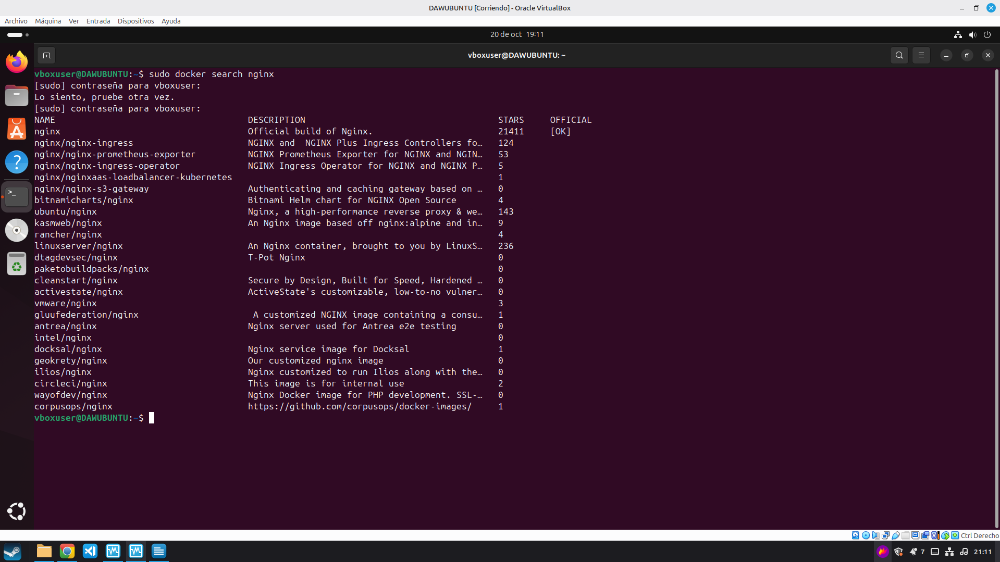

*Figura 7. Búsqueda de imágenes de Nginx.*

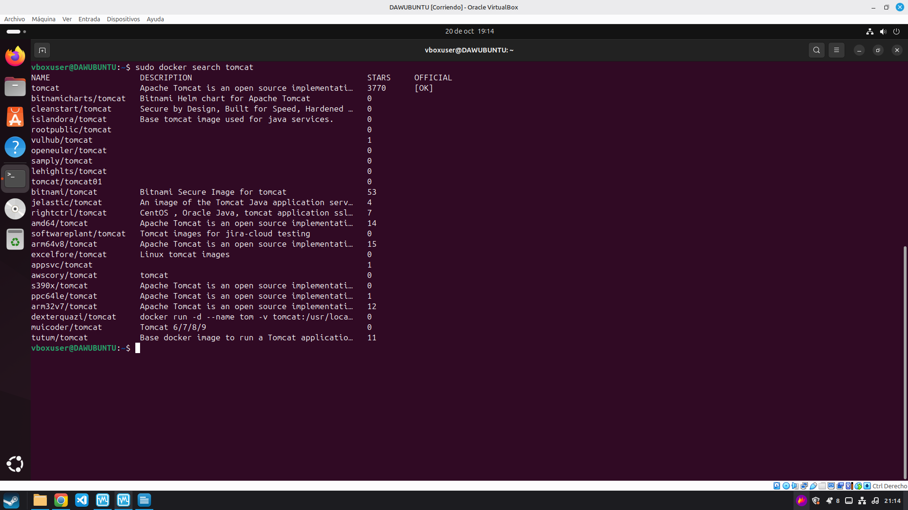

*Figura 8. Búsqueda de imágenes de Tomcat.*

En ambos casos el primer resultado es la imagen oficial, marcada con `[OK]` en la columna *OFFICIAL*: `nginx` (más de 21.000 estrellas) y `tomcat` (unas 3.700). El resto son imágenes de terceros, por lo que conviene usar la oficial.

### 4.3 Descarga e inicio de los contenedores

Con `docker run` se descarga la imagen, si no está ya en el equipo, y se inicia el contenedor:

```bash
sudo docker run -d -p 8080:80 --name webserver nginx
sudo docker run -d -p 8081:8080 --name appserver tomcat
```

| Opción | Significado |
| --- | --- |
| `-d` | Ejecuta el contenedor en segundo plano (*detached*). |
| `-p 8080:80` | Publica el puerto 80 del contenedor en el puerto 8080 del equipo, de forma que `localhost:8080` llega a Nginx. |
| `-p 8081:8080` | Publica el puerto 8080 de Tomcat en el puerto 8081 del equipo. |
| `--name` | Asigna un nombre al contenedor (`webserver` y `appserver`) para identificarlo. |
| `nginx` / `tomcat` | Imagen que se usa. Sin etiqueta se descarga la última (`latest`). |

Los puertos del equipo son distintos (8080 y 8081) para que los dos contenedores no compitan por el mismo puerto.

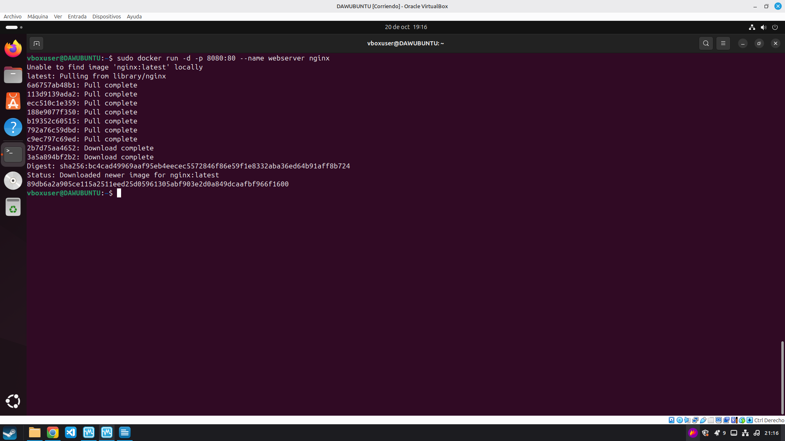

*Figura 9. Creación del contenedor `webserver` con la imagen de Nginx.*

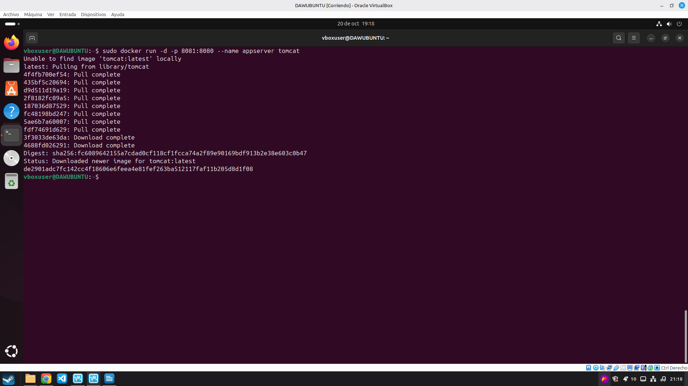

*Figura 10. Creación del contenedor `appserver` con la imagen de Tomcat.*

En las dos capturas se ve el mensaje *Unable to find image ... locally*, porque las imágenes no estaban descargadas. Docker las baja por capas (cada línea *Pull complete* es una capa), termina con *Downloaded newer image* y devuelve el identificador del contenedor creado.

### 4.4 Verificación de los contenedores activos

Se comprueba que ambos contenedores están en marcha con `docker ps`:

```bash
sudo docker ps
```

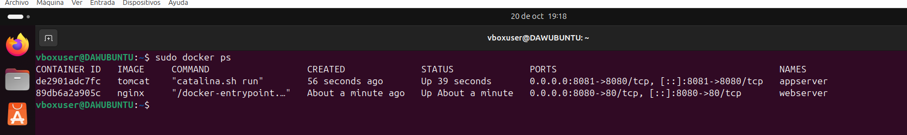

*Figura 11. Contenedores activos.*

La salida muestra los dos contenedores con estado *Up*:

| Contenedor | Imagen | Comando | Puertos |
| --- | --- | --- | --- |
| `webserver` | `nginx` | `/docker-entrypoint.…` | `8080 -> 80/tcp` |
| `appserver` | `tomcat` | `catalina.sh run` | `8081 -> 8080/tcp` |

### 4.5 Pruebas desde el navegador

Por último, se abren las dos direcciones en el navegador de la máquina virtual.

**Nginx en `http://localhost:8080`:**

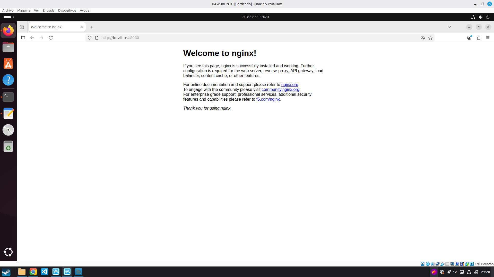

*Figura 12. Nginx responde en el puerto 8080.*

Se muestra la página *Welcome to nginx!*, que confirma que el servidor está instalado y funciona.

**Tomcat en `http://localhost:8081`:**

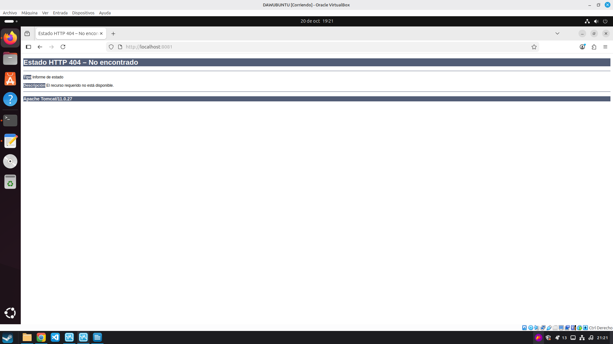

*Figura 13. Tomcat responde en el puerto 8081 con una página de error 404.*

El navegador muestra *Estado HTTP 404 – No encontrado* y, en la parte inferior, la versión *Apache Tomcat/11.0.27*. Esta respuesta es correcta: la página de error la genera el propio Tomcat, lo que demuestra que el servidor está funcionando, y el 404 aparece porque la imagen oficial de Tomcat se entrega sin aplicaciones desplegadas en la raíz. Para ver la página de inicio habría que copiar a la carpeta `webapps` las aplicaciones de ejemplo que la imagen guarda aparte, o desplegar una aplicación propia.

---

## 5. Requerimientos mínimos para implantar una aplicación web

### 5.1 Estructura y recursos de una aplicación web

Una aplicación web se compone normalmente de varias partes que se despliegan sobre servidores distintos o sobre el mismo:

| Parte | Contenido | Dónde se ejecuta |
| --- | --- | --- |
| **Cliente (frontend)** | HTML, CSS, JavaScript e imágenes que recibe el navegador | Navegador, servido por el servidor web |
| **Lógica de negocio (backend)** | Código que procesa las peticiones, por ejemplo en Java | Servidor de aplicaciones (Tomcat) |
| **Datos** | Base de datos y archivos subidos por los usuarios | Servidor de base de datos o almacenamiento |
| **Configuración** | Puertos, credenciales, variables de entorno, certificados | Archivos de cada servidor |

En Java, una aplicación se empaqueta en un archivo `.war` que se despliega en la carpeta `webapps` de Tomcat.

### 5.2 Hardware y software

Los valores siguientes son orientativos para una aplicación pequeña. En un caso real se ajustan según el número de usuarios simultáneos y se afinan midiendo el consumo.

| Recurso | Mínimo orientativo | Observaciones |
| --- | --- | --- |
| **CPU** | 2 núcleos | Más si hay mucha concurrencia o procesamiento pesado. |
| **Memoria RAM** | 2 GB (4 GB si hay base de datos o una aplicación Java real) | Tomcat y la base de datos son los que más consumen. |
| **Disco** | 20 GB, mejor SSD | Sistema, imágenes de contenedores, registros y datos. |
| **Red** | Una interfaz, con conexión estable | La velocidad depende del tráfico esperado. |

En esta práctica, los 4 GB de RAM y los 50 GB de disco recomendados para la máquina virtual cubren con holgura Ubuntu, Docker y los dos contenedores. Docker Desktop para Linux, además, necesita un sistema Linux de 64 bits con soporte de virtualización KVM y al menos 4 GB de RAM.

Software necesario:

- **Sistema operativo:** una distribución Linux estable con soporte a largo plazo, como Ubuntu Server LTS.
- **Servidor web:** Nginx o Apache.
- **Servidor de aplicaciones:** Tomcat, que necesita Java. Tomcat 11 requiere Java 17 o superior. Con la imagen de Docker esto ya viene incluido y no hay que instalarlo en el equipo.
- **Base de datos**, si la aplicación la usa: por ejemplo MySQL o PostgreSQL.
- **Docker**, si se despliega con contenedores.
- **Herramientas de administración:** `curl`, un editor de texto, y el cliente de acceso remoto (SSH) si el servidor no tiene pantalla.

### 5.3 Infraestructura de red

- **Dirección IP fija** para el servidor, de modo que siempre se pueda localizar.
- **Nombre de dominio y DNS** que apunten a esa IP. En pruebas locales se puede usar el archivo `/etc/hosts`, como se hizo en el documento de Apache.
- **Puertos abiertos:** 80 para HTTP y 443 para HTTPS. Los puertos del servidor de aplicaciones (como el 8080 de Tomcat) normalmente no se exponen a Internet.
- **Cortafuegos** que bloquee todo lo que no sea necesario.
- **Proxy inverso** (Nginx o Apache) delante del servidor de aplicaciones, que recibe las peticiones de fuera y las reenvía.
- **Certificado TLS** para cifrar las comunicaciones, como se explica en el documento de [HTTPS](../../../Tema_3_Servidores-web/Ejercicios/Ejercicio_ACT_3/03_https.md).

En la práctica, la máquina virtual usa red NAT. Con este tipo de red la máquina puede salir a Internet (lo necesita para descargar paquetes e imágenes), pero no es accesible desde fuera sin una regla de reenvío de puertos. Por eso todas las pruebas se hacen desde el navegador de la propia máquina, con `localhost`.

### 5.4 Configuración del servidor web y del servidor de aplicaciones

- **Servidor web:** define qué sitios sirve (hosts virtuales o bloques `server`), la carpeta de los archivos, los puertos y los certificados. Puede servir los archivos estáticos directamente y reenviar el resto de peticiones a la aplicación.
- **Servidor de aplicaciones:** se configura el puerto en el que escucha, la memoria que se asigna a la máquina virtual de Java y la carpeta de despliegue. Las aplicaciones se instalan copiando el `.war` a `webapps`.
- **Comunicación entre ambos:** lo habitual es que el servidor web actúe como proxy inverso del servidor de aplicaciones. Como ejemplo de referencia, en Nginx se haría con un bloque como este, suponiendo que los dos contenedores estén en la misma red de Docker (no se ha realizado en esta práctica):

```nginx
server {
    listen 80;

    location / {
        proxy_pass http://appserver:8080;
    }
}
```

- **Con contenedores:** hay que decidir qué puertos se publican con `-p`, qué datos deben conservarse mediante volúmenes (sin ellos, los datos se pierden al borrar el contenedor) y qué contenedores comparten red.

### 5.5 Seguridad y mantenimiento

| Área | Medidas |
| --- | --- |
| **Actualizaciones** | Mantener al día el sistema operativo, el servidor web, Tomcat y las imágenes de Docker. Usar versiones concretas de las imágenes en lugar de `latest` para que los despliegues sean repetibles. |
| **Cifrado** | Usar HTTPS con certificados válidos y redirigir HTTP a HTTPS. |
| **Accesos** | Contraseñas robustas, mínimo privilegio y no usar el usuario root para ejecutar los servicios. Restringir las aplicaciones de administración de Tomcat. |
| **Superficie de ataque** | Eliminar las páginas y aplicaciones de ejemplo, cerrar los puertos que no se usen y no exponer el servidor de aplicaciones directamente. |
| **Contenedores** | Usar imágenes oficiales, limitar sus recursos y tener presente que acceder al socket de Docker equivale a tener permisos de administrador sobre el equipo. |
| **Supervisión** | Revisar los registros (*logs*) y vigilar el consumo de CPU, memoria y disco. |
| **Copias de seguridad** | Copiar periódicamente los datos, la configuración y los volúmenes, y comprobar que se pueden restaurar. |

---

## 6. Banco de pruebas

| Nº | Prueba | Comando o acción | Resultado esperado | Resultado obtenido |
| --- | --- | --- | --- | --- |
| 1 | Ubuntu arranca en VirtualBox | Iniciar la máquina virtual | Escritorio visible | Correcto (Figura 1) |
| 2 | Actualización del sistema | `sudo apt update && sudo apt upgrade -y` | Termina sin errores | Correcto (Figura 2) |
| 3 | Dependencias | `sudo apt install ca-certificates curl gnupg -y` | Paquetes instalados o ya actualizados | Correcto (Figura 3) |
| 4 | Instalación de Docker Engine | `curl -fsSL https://get.docker.com \| sudo sh` | Docker instalado | Correcto (Figura 4) |
| 5 | Instalación de Docker Desktop con `apt` | `sudo apt install docker-desktop -y` | Paquete instalado | Error: paquete no localizado (Figura 4) |
| 6 | Instalación de Docker Desktop desde `.deb` | `sudo apt install ./docker-desktop-amd64.deb` | Paquete configurado | Correcto (Figura 5) |
| 7 | Versión de Docker | `docker --version` | Muestra la versión | Correcto: 29.9.1 (Figura 6) |
| 8 | Contenedor de prueba sin `sudo` | `docker run hello-world` | Mensaje de bienvenida | Error de permisos (Figura 6) |
| 9 | Contenedor de prueba con `sudo` | `sudo docker run hello-world` | Mensaje de bienvenida | Correcto (Figura 6) |
| 10 | Búsqueda de imágenes | `sudo docker search nginx` y `tomcat` | Lista con la imagen oficial | Correcto (Figuras 7 y 8) |
| 11 | Contenedor de Nginx | `sudo docker run -d -p 8080:80 --name webserver nginx` | Imagen descargada y contenedor creado | Correcto (Figura 9) |
| 12 | Contenedor de Tomcat | `sudo docker run -d -p 8081:8080 --name appserver tomcat` | Imagen descargada y contenedor creado | Correcto (Figura 10) |
| 13 | Contenedores activos | `sudo docker ps` | Los dos en estado *Up* | Correcto (Figura 11) |
| 14 | Acceso a Nginx | `http://localhost:8080` | Página de Nginx | Correcto (Figura 12) |
| 15 | Acceso a Tomcat | `http://localhost:8081` | Respuesta de Tomcat | Correcto: responde con un 404 en la raíz (Figura 13) |

## 7. Resultados, valoración y conclusiones

### 7.1 Resultados

Se ha conseguido un entorno de virtualización completo: Ubuntu 24.04 funcionando en una máquina virtual de VirtualBox, con Docker instalado en ella. Docker Engine se instaló con el script oficial y Docker Desktop, tras fallar la instalación mediante `apt`, se instaló desde el paquete `.deb`. La instalación se verificó con `docker --version` y con el contenedor `hello-world`.

Sobre ese entorno se han desplegado dos contenedores, un servidor web (Nginx) y un servidor de aplicaciones (Tomcat), accesibles en los puertos 8080 y 8081 y comprobados con `docker ps` y desde el navegador. Nginx muestra su página de bienvenida y Tomcat responde con su página de error 404 en la raíz, lo que confirma que ambos servicios están activos. También se han descrito los requerimientos mínimos para implantar una aplicación web.

### 7.2 Dificultades encontradas

- **`docker-desktop` no localizado.** La instalación con `sudo apt install docker-desktop -y` falló porque el paquete no está en los repositorios configurados. Se resolvió descargando el paquete `.deb` desde la web de Docker e instalándolo desde el archivo.
- **Permisos de Docker.** Sin `sudo`, los comandos `docker` fallan porque el usuario no puede acceder al socket del servicio. Se resolvió usando `sudo`. La alternativa más cómoda a largo plazo sería añadir el usuario al grupo `docker`.
- **404 en Tomcat.** Al abrir Tomcat en el navegador aparece un error 404. No es un fallo de instalación: la imagen oficial no trae aplicaciones en la raíz. Se ha tomado como prueba de que el servidor está funcionando.
- **Aviso de acceso al archivo `.deb`.** Al instalar desde la carpeta personal, `apt` avisa de que el archivo no es accesible para el usuario `_apt`. Es un aviso informativo que no impide la instalación.

### 7.3 Valoración personal

Lo que más me ha enseñado esta práctica es que no todo sale como indica el enunciado: el comando para instalar Docker Desktop no funcionó y tuve que buscar cómo se instala realmente. También me ha quedado claro cuánto más rápido es trabajar con contenedores que con una máquina virtual: en un par de comandos tenía un servidor web y uno de aplicaciones funcionando, sin instalar nada a mano ni configurar dependencias. La parte de los requerimientos me ha servido para ver que desplegar una aplicación real implica bastante más que arrancar el servidor: red, seguridad, actualizaciones y copias de seguridad.

### 7.4 Criterios de evaluación

| Criterio | Dónde se cumple |
| --- | --- |
| **1c.** Instalación y configuración básica de servidores web | Contenedor de Nginx (apartado 4) |
| **1d.** Instalación y configuración básica de servidores de aplicaciones | Contenedor de Tomcat (apartado 4) |
| **1e.** Instalación y configuración básica de tecnologías de virtualización en contenedores | VirtualBox y Docker (apartados 2 y 3) |
| **1f.** Pruebas de funcionamiento | Apartados 4.4 y 4.5, y banco de pruebas (apartado 6) |
| **1g.** Estructura y recursos de una aplicación web | Apartado 5.1 |
| **1h.** Requerimientos de implantación de una aplicación web | Apartado 5 |
| **1i.** Documentación de los procesos de instalación y configuración | Este documento |

---

## 8. Bibliografía

- Oracle. *Oracle VirtualBox User Manual.* https://www.virtualbox.org/manual/
- Canonical. *Descarga de Ubuntu Desktop.* https://ubuntu.com/download/desktop
- Docker. *Install Docker Desktop on Ubuntu.* https://docs.docker.com/desktop/setup/install/linux/ubuntu/
- Docker. *Install Docker Engine on Ubuntu.* https://docs.docker.com/engine/install/ubuntu/
- Docker. *Linux post-installation steps for Docker Engine.* https://docs.docker.com/engine/install/linux-postinstall/
- Docker. *Get started.* https://docs.docker.com/get-started/
- Docker. *docker container run (referencia).* https://docs.docker.com/reference/cli/docker/container/run/
- Docker Hub. *Imagen oficial de Nginx.* https://hub.docker.com/_/nginx
- Docker Hub. *Imagen oficial de Tomcat.* https://hub.docker.com/_/tomcat
- The Apache Software Foundation. *Apache Tomcat.* https://tomcat.apache.org/
- Nginx. *Documentación de nginx.* https://nginx.org/en/docs/

## 9. Anexo: comandos de Docker usados

Resumen en el orden en que se ejecutaron, con algunos comandos de uso habitual que complementan la práctica.

```bash
# Preparación del sistema
sudo apt update && sudo apt upgrade -y
sudo apt install ca-certificates curl gnupg -y

# Docker Engine y Docker Desktop
curl -fsSL https://get.docker.com | sudo sh
sudo apt install ./docker-desktop-amd64.deb

# Verificación
docker --version
sudo docker run hello-world

# Imágenes y contenedores de la práctica
sudo docker search nginx
sudo docker search tomcat
sudo docker run -d -p 8080:80 --name webserver nginx
sudo docker run -d -p 8081:8080 --name appserver tomcat
sudo docker ps
```

Comandos habituales que complementan los anteriores (no usados en la práctica):

| Comando | Para qué sirve |
| --- | --- |
| `sudo docker ps -a` | Lista todos los contenedores, también los detenidos. |
| `sudo docker stop webserver` | Detiene el contenedor `webserver`. |
| `sudo docker start webserver` | Vuelve a iniciar un contenedor detenido. |
| `sudo docker rm webserver` | Elimina un contenedor detenido. |
| `sudo docker logs appserver` | Muestra los registros del contenedor. |
| `sudo docker images` | Lista las imágenes descargadas. |
