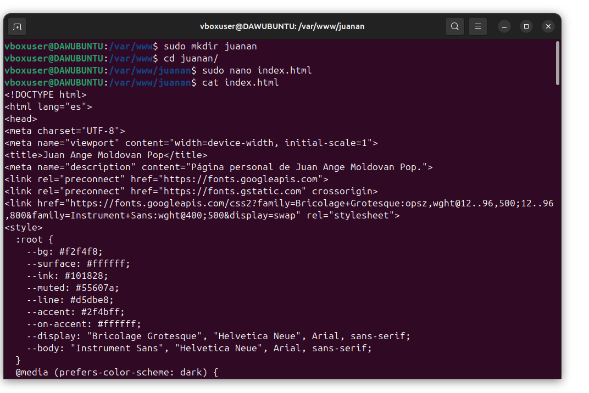
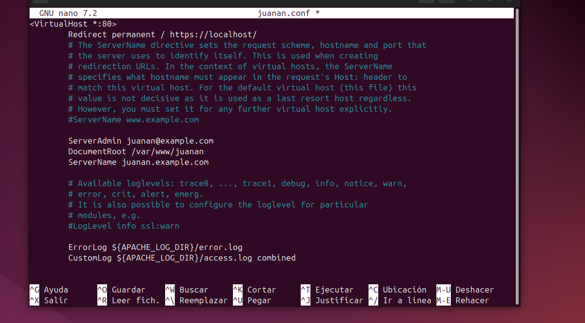
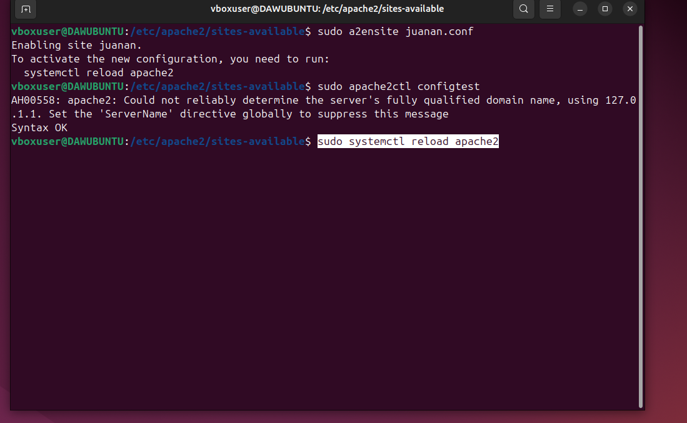
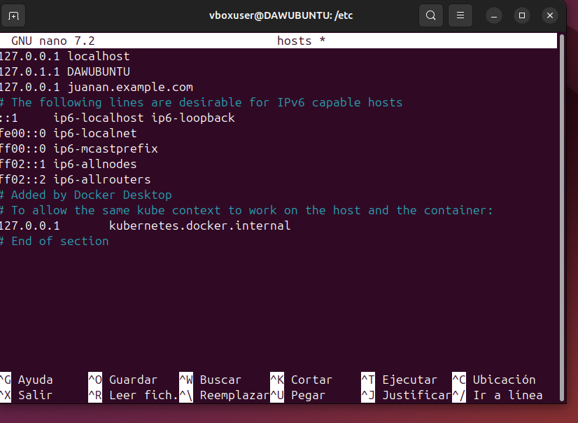

# Apache: configuración de un sitio web con VirtualHost

Este documento es la segunda parte de la memoria. Sigue los pasos 3, 4 y 5 del tutorial de Ubuntu *Install and configure Apache*: crear una página web, definir su VirtualHost y activarlo. La introducción general está en [01_introduccion.md](../Ejercicio_ACT_1/01_introduccion.md) y la parte de HTTPS en [03_https.md](../Ejercicio_ACT_3/03_https.md).

## Índice

1. [Relación de las actividades realizadas](#1-relación-de-las-actividades-realizadas)
   1. [Punto de partida](#11-punto-de-partida)
   2. [Creación de la página web (paso 3)](#12-creación-de-la-página-web-paso-3)
   3. [Archivo del VirtualHost (paso 4)](#13-archivo-del-virtualhost-paso-4)
   4. [Activación del sitio (paso 5)](#14-activación-del-sitio-paso-5)
   5. [Resolución del nombre en local](#15-resolución-del-nombre-en-local)
   6. [Comprobación en el navegador](#16-comprobación-en-el-navegador)
2. [Problemas encontrados](#2-problemas-encontrados)
3. [Banco de pruebas](#3-banco-de-pruebas)
4. [Presentación y valoración de resultados](#4-presentación-y-valoración-de-resultados)
5. [Conclusión](#5-conclusión)
6. [Bibliografía](#6-bibliografía)
7. [Anexo: rutas y comandos útiles de Apache en Ubuntu](#7-anexo-rutas-y-comandos-útiles-de-apache-en-ubuntu)

---

## 1. Relación de las actividades realizadas

### 1.1 Punto de partida

El tutorial parte de Apache2 ya instalado y funcionando, algo que se comprueba en el apartado 2.1 de [03_https.md](../Ejercicio_ACT_3/03_https.md). Todo el trabajo se hace desde la terminal de la máquina virtual. Los comandos llevan `sudo` porque las carpetas `/var/www` y `/etc/apache2` pertenecen al usuario root.

### 1.2 Creación de la página web (paso 3)

Cada sitio necesita su propia carpeta. Se crea `/var/www/juanan` y dentro se escribe un `index.html`:

```bash
cd /var/www
sudo mkdir juanan
cd juanan/
sudo nano index.html
cat index.html
```



*Figura 1. Creación de `/var/www/juanan` y comienzo del contenido de `index.html`.*

La página es una sola hoja HTML5 con el CSS incluido en el propio archivo. El diseño se define con variables CSS en `:root` (colores de fondo, texto y acento, y las tipografías), y hay un bloque `@media (prefers-color-scheme: dark)` para que la página cambie de aspecto si el sistema usa modo oscuro. Las tipografías se cargan desde Google Fonts (Bricolage Grotesque e Instrument Sans) con Helvetica Neue y Arial como alternativa por si no hay conexión. El resultado visible se muestra en la [Figura 5](#16-comprobación-en-el-navegador): una cabecera con las secciones *Sobre mí*, *Proyectos* y *Contacto*, un título grande con el nombre, un texto de presentación y dos botones.

### 1.3 Archivo del VirtualHost (paso 4)

Un VirtualHost indica a Apache qué sitio debe servir según el nombre con el que se le pide. Se crea el archivo `/etc/apache2/sites-available/juanan.conf`:

```bash
sudo nano /etc/apache2/sites-available/juanan.conf
```



*Figura 2. Archivo `juanan.conf` en el editor nano.*

Las directivas principales del bloque son estas:

| Directiva | Valor | Para qué sirve |
| --- | --- | --- |
| `<VirtualHost *:80>` | `*:80` | El bloque atiende peticiones al puerto 80 por cualquier dirección IP del equipo. |
| `ServerAdmin` | `juanan@example.com` | Correo del administrador. Apache lo muestra en algunas páginas de error. |
| `DocumentRoot` | `/var/www/juanan` | Carpeta donde están los archivos del sitio. |
| `ServerName` | `juanan.example.com` | Nombre del sitio. Apache lo compara con el nombre que pide el cliente para elegir el VirtualHost. |
| `ErrorLog` | `${APACHE_LOG_DIR}/error.log` | Archivo donde se guardan los errores. |
| `CustomLog` | `${APACHE_LOG_DIR}/access.log combined` | Registro de accesos en formato *combined*. |

El resto de líneas de la captura son los comentarios de la plantilla por defecto de Apache, que explican cada directiva. En la captura aparece también una directiva `Redirect permanent` al principio del bloque. Pertenece a la parte de HTTPS y no a los pasos 3 a 5 del tutorial, por lo que se explica en [03_https.md](../Ejercicio_ACT_3/03_https.md).

### 1.4 Activación del sitio (paso 5)

Un archivo en `sites-available` no se usa hasta que se activa. Se hace con `a2ensite`, que crea un enlace simbólico en `sites-enabled`. Antes de aplicar el cambio se comprueba la sintaxis con `apache2ctl configtest` y después se recarga el servicio:

```bash
sudo a2ensite juanan.conf
sudo apache2ctl configtest
sudo systemctl reload apache2
```



*Figura 3. Activación del sitio, comprobación de sintaxis y recarga de Apache.*

La salida confirma `Enabling site juanan.` y, tras el aviso del nombre de servidor que se explica en el apartado de problemas, indica `Syntax OK`. Se usa `reload` y no `restart` porque recarga la configuración sin cortar las conexiones que haya abiertas.

### 1.5 Resolución del nombre en local

El dominio `example.com` está reservado para ejemplos y documentación, así que `juanan.example.com` no existe en ningún DNS. Para que la máquina lo traduzca a sí misma se añade una línea al archivo `/etc/hosts`:

```bash
sudo nano /etc/hosts
```



*Figura 4. Archivo `/etc/hosts` con la entrada `127.0.0.1 juanan.example.com`.*

La línea añadida es `127.0.0.1 juanan.example.com`. Las demás entradas del archivo ya estaban y no se han modificado.

### 1.6 Comprobación en el navegador

Con el sitio activado y el nombre resuelto, se abre `http://juanan.example.com` en el navegador de la máquina virtual.


*Figura 5. Página personal servida por Apache en `http://juanan.example.com`.*

La página se carga con el diseño esperado. El navegador la marca como «No seguro» porque la conexión HTTP no va cifrada, y esa es la razón de añadir HTTPS en la parte siguiente.

---

## 2. Problemas encontrados

**Aviso AH00558.** Al comprobar y recargar la configuración, Apache muestra el mensaje *Could not reliably determine the server's fully qualified domain name, using 127.0.1.1*. No es un error: Apache funciona con normalidad y la sintaxis se da por buena. Aparece porque no hay una directiva `ServerName` global, solo la de cada VirtualHost. Se puede eliminar definiendo un `ServerName` a nivel general en la configuración de Apache. Aquí se ha dejado tal cual, y el mensaje reaparece en las capturas del documento de HTTPS.

**El dominio no resolvía.** Al ser `example.com` un dominio reservado, el navegador no encontraba `juanan.example.com`. Se resolvió añadiendo la entrada a `/etc/hosts`. Con esta solución el nombre solo funciona en la máquina donde se ha editado el archivo.

## 3. Banco de pruebas

| Nº | Prueba | Cómo se hace | Resultado esperado | Resultado obtenido |
| --- | --- | --- | --- | --- |
| 1 | Sintaxis de la configuración | `sudo apache2ctl configtest` | `Syntax OK` | Correcto, con el aviso AH00558 (Figura 3) |
| 2 | Activación del sitio | `sudo a2ensite juanan.conf` | `Enabling site juanan.` | Correcto (Figura 3) |
| 3 | Recarga sin errores | `sudo systemctl reload apache2` | El comando termina sin mensajes de error | Correcto (Figura 3) |
| 4 | Resolución del nombre | Entrada en `/etc/hosts` | `juanan.example.com` apunta a `127.0.0.1` | Correcto (Figura 4) |
| 5 | Acceso al sitio | Abrir `http://juanan.example.com` en el navegador | Se muestra la página personal | Correcto (Figura 5) |

Todas las pruebas se han hecho desde la propia máquina virtual, que es donde se resuelve el nombre del sitio.

## 4. Presentación y valoración de resultados

### 4.1 Resultados

Se ha creado una página web personal y se ha publicado con Apache en un VirtualHost propio, con su carpeta (`/var/www/juanan`), su nombre (`juanan.example.com`) y sus archivos de registro. La configuración ha pasado la comprobación de sintaxis y el sitio se ha activado y recargado sin errores. La página es accesible por HTTP desde el navegador con el diseño previsto. El único aviso que ha aparecido en todo el proceso es el AH00558, que no afecta al funcionamiento.

### 4.2 Valoración personal

Lo que más me ha servido de esta parte es ver cómo encajan las piezas: los archivos del sitio por un lado, el VirtualHost que los asocia a un nombre por otro, y el paso final de activarlo. El orden de trabajo que he acabado usando es editar, comprobar con `configtest` y recargar, y creo que es un buen hábito porque evita dejar el servidor con una configuración rota. También me ha parecido útil entender que `/etc/hosts` es una solución local y que para un sitio real haría falta un dominio y un DNS.

## 5. Conclusión

Siguiendo los pasos 3, 4 y 5 del tutorial se ha conseguido servir una página personal con Apache desde un VirtualHost propio, aprendiendo la secuencia de crear el contenido, definir el VirtualHost, activarlo y verificarlo. El sitio funciona por HTTP sin cifrar, por lo que el siguiente paso lógico es protegerlo con HTTPS, que se trata en [03_https.md](../Ejercicio_ACT_3/03_https.md).

## 6. Bibliografía

- Ubuntu. *Install and configure Apache.* https://ubuntu.com/tutorials/install-and-configure-apache
- The Apache Software Foundation. *Apache Virtual Host documentation.* https://httpd.apache.org/docs/2.4/vhosts/
- The Apache Software Foundation. *Name-based Virtual Host Support.* https://httpd.apache.org/docs/2.4/vhosts/name-based.html
- IETF. *RFC 2606: Reserved Top Level DNS Names.* https://www.rfc-editor.org/rfc/rfc2606

## 7. Anexo: rutas y comandos útiles de Apache en Ubuntu

Información que no forma parte directa del trabajo pero resulta práctica.

| Elemento | Ruta o comando |
| --- | --- |
| Configuración principal | `/etc/apache2/apache2.conf` |
| Sitios disponibles | `/etc/apache2/sites-available/` |
| Sitios activados | `/etc/apache2/sites-enabled/` |
| Módulos disponibles y activados | `/etc/apache2/mods-available/` y `/etc/apache2/mods-enabled/` |
| Carpeta de los sitios | `/var/www/` |
| Registros (`${APACHE_LOG_DIR}`) | `/var/log/apache2/` |
| Activar o desactivar un sitio | `sudo a2ensite nombre.conf` / `sudo a2dissite nombre.conf` |
| Activar o desactivar un módulo | `sudo a2enmod nombre` / `sudo a2dismod nombre` |
| Comprobar la sintaxis | `sudo apache2ctl configtest` |
| Aplicar cambios sin cortar conexiones | `sudo systemctl reload apache2` |
| Reiniciar el servicio | `sudo systemctl restart apache2` |
| Ver el estado | `sudo systemctl status apache2` |
