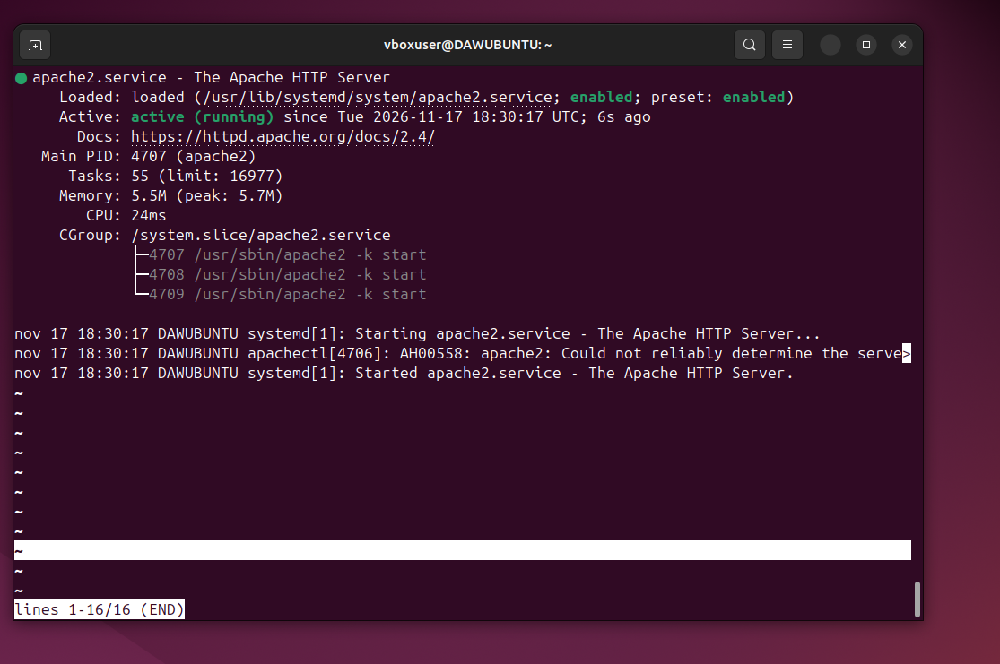
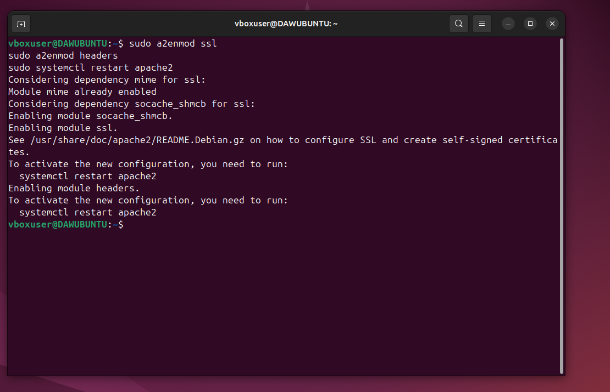
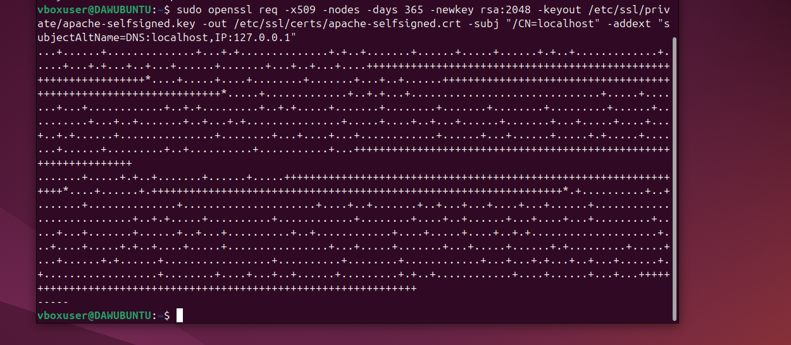
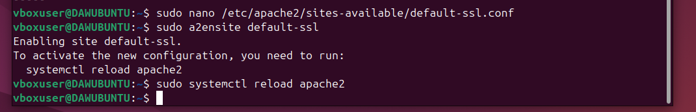
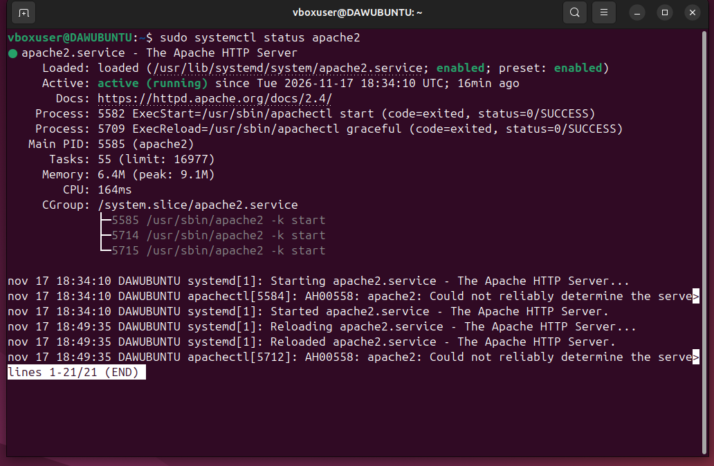
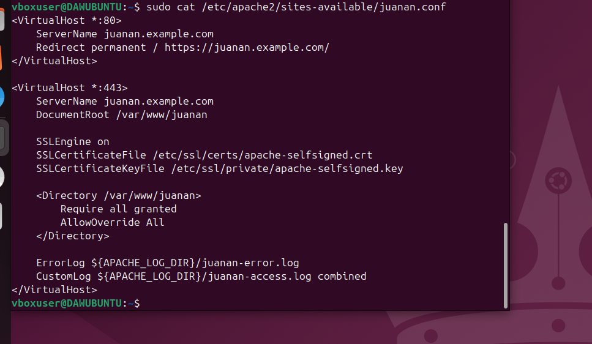
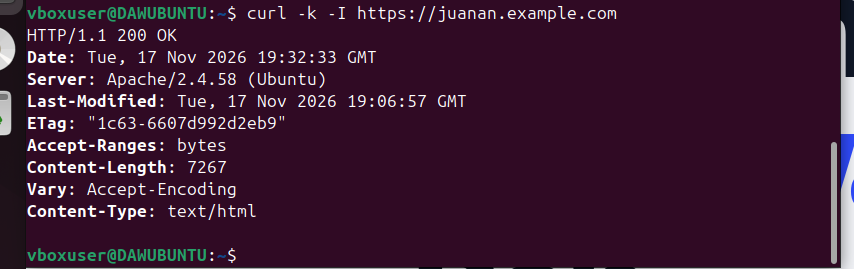
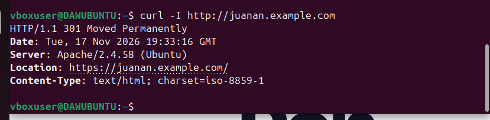

# Implementación de HTTPS

## Apache2 sobre Ubuntu con certificado SSL/TLS

**Memoria**

Noviembre de 2026

---

# Implementación de HTTPS en Apache2 sobre Ubuntu

## Resumen

Este documento explica y documenta la implementación de HTTPS en un servidor Apache2 que se ejecuta sobre Ubuntu. En la parte teórica se describe el funcionamiento del protocolo, su importancia para la seguridad web, los tipos de certificados SSL/TLS y los módulos de Apache necesarios. En la parte práctica se verifica Apache2, se habilitan los módulos `ssl` y `headers`, se genera un certificado autofirmado con OpenSSL, se configura un VirtualHost en el puerto 443 y se añade una redirección permanente de HTTP a HTTPS. La implementación se valida con `curl`, que confirma una respuesta `200 OK` por HTTPS y un `301` en las peticiones HTTP. Se recogen también las dificultades encontradas, entre ellas el aviso del nombre de servidor y las limitaciones propias de un certificado autofirmado.

## Palabras clave

HTTPS, SSL/TLS, Apache2, Ubuntu, certificado autofirmado, OpenSSL, VirtualHost, puerto 443, redirección 301

## Índice

1. [Investigación](#1-investigación)
   1. [Funcionamiento de HTTPS](#11-funcionamiento-de-https)
   2. [Importancia en la seguridad web](#12-importancia-en-la-seguridad-web)
   3. [Tipos de certificados SSL/TLS](#13-tipos-de-certificados-ssltls)
   4. [Módulos de Apache2 necesarios](#14-módulos-de-apache2-necesarios)
2. [Ejecución técnica](#2-ejecución-técnica)
   1. [Instalación y verificación de Apache2](#21-instalación-y-verificación-de-apache2)
   2. [Habilitar los módulos ssl y headers](#22-habilitar-los-módulos-ssl-y-headers)
   3. [Generación del certificado](#23-generación-del-certificado)
   4. [VirtualHost en el puerto 443](#24-virtualhost-en-el-puerto-443)
   5. [Redirección de HTTP a HTTPS](#25-redirección-de-http-a-https)
   6. [Validación](#26-validación)
3. [Banco de pruebas](#3-banco-de-pruebas)
4. [Presentación y valoración de resultados](#4-presentación-y-valoración-de-resultados)
5. [Conclusiones](#5-conclusiones)
6. [Bibliografía](#6-bibliografía)
7. [Anexo: resumen de comandos](#7-anexo-resumen-de-comandos)

---

## 1. Investigación

### 1.1 Funcionamiento de HTTPS

HTTPS es el protocolo HTTP transportado sobre una conexión cifrada con TLS (*Transport Layer Security*), el sucesor de SSL. Por eso se habla indistintamente de «certificados SSL» o «certificados TLS». Por defecto usa el puerto 443, mientras que HTTP usa el 80.

Antes de enviar ningún dato de la página, cliente y servidor hacen un acuerdo inicial llamado *handshake*:

1. El cliente envía un mensaje de saludo con las versiones de TLS y las suites de cifrado que soporta, y el nombre del sitio que quiere visitar (extensión SNI). Este último dato es lo que permite al servidor elegir el certificado correcto cuando aloja varios sitios.
2. El servidor responde con la versión y la suite de cifrado elegidas y envía su certificado.
3. El cliente comprueba el certificado: que lo haya firmado una autoridad en la que confía, que no haya caducado y que corresponda al nombre del sitio.
4. Ambos acuerdan una clave de sesión mediante un intercambio de claves (en las versiones actuales, Diffie-Hellman efímero), de forma que nadie que escuche la conexión pueda deducirla.
5. A partir de ahí todo el tráfico HTTP se cifra con esa clave de sesión usando un algoritmo simétrico, que es mucho más rápido que el cifrado con clave pública, y se protege contra modificaciones.

### 1.2 Importancia en la seguridad web

HTTPS aporta tres garantías:

- **Confidencialidad:** nadie que esté en medio del camino (por ejemplo en una wifi pública) puede leer contraseñas, formularios o cookies.
- **Integridad:** el contenido no se puede alterar por el camino sin que se detecte, lo que evita que se inyecte publicidad o código en la página.
- **Autenticidad:** el certificado permite comprobar que el servidor es realmente el del dominio que se visita y no una suplantación.

Además, hoy es casi obligatorio: los navegadores marcan como «No seguro» las páginas HTTP (se puede ver en la [Figura 5 del documento anterior](../Ejercicio_ACT_2/02_configuracion.md#16-comprobación-en-el-navegador)), y muchas funciones modernas del navegador solo están disponibles en conexiones seguras.

### 1.3 Tipos de certificados SSL/TLS

Un certificado vincula una clave pública con un nombre de dominio, y va firmado. Lo que cambia entre tipos es quién lo firma.

| | Autofirmado | Emitido por una CA de confianza |
| --- | --- | --- |
| **Quién firma** | El propio servidor, con su clave privada | Una autoridad certificadora reconocida por los navegadores |
| **Coste** | Gratuito | Gratuito (Let's Encrypt) o de pago (CA comerciales) |
| **Obtención** | Inmediata, con `openssl` | Requiere demostrar el control del dominio |
| **Confianza del navegador** | No. Muestra una advertencia de seguridad | Sí, de forma automática |
| **Uso habitual** | Pruebas, laboratorios y redes internas | Sitios públicos |

El certificado autofirmado cifra la conexión igual de bien, pero no permite comprobar la identidad del servidor, y por eso los navegadores avisan. Con una CA de confianza, el navegador acepta el certificado porque ya tiene guardado el certificado raíz de esa autoridad.

Let's Encrypt es una CA gratuita y automatizada. Con la herramienta Certbot, que gestiona la petición, la instalación y la renovación del certificado, se obtienen certificados de corta duración que se renuevan solos. Para ello necesita validar que el solicitante controla un dominio público, algo que no es posible en este trabajo (se explica en el apartado 2.3).

### 1.4 Módulos de Apache2 necesarios

| Módulo | Para qué se usa | Estado en este trabajo |
| --- | --- | --- |
| `ssl` (mod_ssl) | Añade soporte SSL/TLS a Apache mediante OpenSSL. Es el módulo imprescindible. | Habilitado con `a2enmod` |
| `socache_shmcb` | Guarda en memoria compartida la caché de sesiones SSL. `ssl` depende de él. | Se activa solo como dependencia |
| `mime` | Dependencia de `ssl` para los tipos de archivo. | Ya estaba activo |
| `headers` (mod_headers) | Permite añadir o modificar cabeceras HTTP, por ejemplo las de seguridad como HSTS. | Habilitado con `a2enmod` |
| `alias` (mod_alias) | Proporciona la directiva `Redirect` usada para la redirección. | Activo por defecto en Ubuntu |
| `rewrite` (mod_rewrite) | Alternativa más flexible para redirecciones con condiciones. | No se usa |

---

## 2. Ejecución técnica

### 2.1 Instalación y verificación de Apache2

Apache2 se instala desde los repositorios de Ubuntu y después se comprueba el estado del servicio:

```bash
sudo apt update
sudo apt install apache2
sudo systemctl status apache2
```



*Figura 1. Salida de `systemctl status apache2`.*

La salida indica que la unidad está cargada y habilitada (`enabled`, es decir, arranca con el sistema) y en estado `active (running)`, con el proceso principal y dos procesos de trabajo. La última línea del registro muestra el aviso AH00558 sobre el nombre de servidor, que se comenta en el apartado de dificultades.

### 2.2 Habilitar los módulos ssl y headers

Los dos módulos se activan con `a2enmod` y después se reinicia Apache para que los cargue:

```bash
sudo a2enmod ssl
sudo a2enmod headers
sudo systemctl restart apache2
```



*Figura 2. Activación de los módulos `ssl` y `headers`.*

La salida muestra que `ssl` activa además `socache_shmcb` como dependencia (`mime` ya estaba activo) y que `headers` también queda habilitado. Cada uno recuerda que hace falta reiniciar Apache para aplicar el cambio. También indica que en `/usr/share/doc/apache2/README.Debian.gz` hay información sobre cómo configurar SSL con certificados autofirmados.

### 2.3 Generación del certificado

Se ha elegido la **Opción A, certificado autofirmado**. La Opción B (Let's Encrypt con Certbot) no es viable aquí por dos motivos: el sitio se llama `juanan.example.com`, un dominio reservado que no se puede registrar, y el servidor no es accesible desde Internet, que es lo que Let's Encrypt necesita para validar el dominio.

El certificado se genera con OpenSSL en una sola orden:

```bash
sudo openssl req -x509 -nodes -days 365 -newkey rsa:2048 \
  -keyout /etc/ssl/private/apache-selfsigned.key \
  -out /etc/ssl/certs/apache-selfsigned.crt \
  -subj "/CN=localhost" \
  -addext "subjectAltName=DNS:localhost,IP:127.0.0.1"
```



*Figura 3. Generación de la clave y del certificado autofirmado.*

Significado de las opciones:

| Opción | Función |
| --- | --- |
| `req -x509` | Crea directamente un certificado autofirmado en lugar de una solicitud de firma. |
| `-nodes` | No protege la clave privada con contraseña, para que Apache pueda arrancar sin que nadie la escriba. |
| `-days 365` | El certificado es válido durante un año. |
| `-newkey rsa:2048` | Genera una clave RSA nueva de 2048 bits. |
| `-keyout` | Archivo de la clave privada, en `/etc/ssl/private/`, una carpeta de acceso restringido. |
| `-out` | Archivo del certificado, en `/etc/ssl/certs/`. |
| `-subj "/CN=localhost"` | Nombre del titular del certificado. |
| `-addext "subjectAltName=..."` | Nombres alternativos válidos. Los navegadores actuales comprueban este campo y no solo el CN. |

Los puntos y signos `+` que se ven en la captura son la barra de progreso de OpenSSL mientras busca los números primos de la clave. Termina sin errores y devuelve el prompt.

### 2.4 VirtualHost en el puerto 443

Ubuntu incluye con el paquete de Apache una plantilla de sitio HTTPS, `default-ssl.conf`. Se abrió con nano para revisar su contenido, se habilitó con `a2ensite` y se recargó Apache:

```bash
sudo nano /etc/apache2/sites-available/default-ssl.conf
sudo a2ensite default-ssl
sudo systemctl reload apache2
```



*Figura 4. Activación de `default-ssl`.*

Después de la recarga se comprueba de nuevo el estado del servicio:



*Figura 5. Estado de Apache después de reiniciar y recargar.*

En la salida se ve el servicio activo, con `ExecStart` y `ExecReload` terminados con `status=0/SUCCESS`, y en el registro las líneas `Starting`, `Started`, `Reloading` y `Reloaded`. La hora del inicio (18:34:10) corresponde al reinicio hecho tras activar los módulos, y la recarga posterior (18:49:35) a la activación de `default-ssl`.

Para el sitio propio se define su VirtualHost de HTTPS en `/etc/apache2/sites-available/juanan.conf`, junto al del puerto 80:



*Figura 6. Archivo `juanan.conf` con el VirtualHost del puerto 80 (redirección) y el del puerto 443 (HTTPS).*

```apache
<VirtualHost *:443>
    ServerName juanan.example.com
    DocumentRoot /var/www/juanan

    SSLEngine on
    SSLCertificateFile /etc/ssl/certs/apache-selfsigned.crt
    SSLCertificateKeyFile /etc/ssl/private/apache-selfsigned.key

    <Directory /var/www/juanan>
        Require all granted
        AllowOverride All
    </Directory>

    ErrorLog ${APACHE_LOG_DIR}/juanan-error.log
    CustomLog ${APACHE_LOG_DIR}/juanan-access.log combined
</VirtualHost>
```

| Directiva | Función |
| --- | --- |
| `<VirtualHost *:443>` | Atiende las peticiones que llegan al puerto 443. |
| `ServerName` y `DocumentRoot` | Mismo nombre y misma carpeta que el sitio por HTTP, de modo que se sirve la misma página. |
| `SSLEngine on` | Activa TLS en este VirtualHost. |
| `SSLCertificateFile` | Certificado que Apache enviará al cliente. |
| `SSLCertificateKeyFile` | Clave privada correspondiente al certificado. |
| `Require all granted` | Permite el acceso a la carpeta del sitio. |
| `AllowOverride All` | Permite que los archivos `.htaccess` del sitio sobrescriban la configuración. |
| `ErrorLog` y `CustomLog` | Registros propios del sitio, separados de los generales. |

### 2.5 Redirección de HTTP a HTTPS

Para que quien entre por HTTP acabe en la versión segura, el VirtualHost del puerto 80 se reduce a un nombre y una redirección permanente:

```apache
<VirtualHost *:80>
    ServerName juanan.example.com
    Redirect permanent / https://juanan.example.com/
</VirtualHost>
```

`Redirect permanent` es una directiva de `mod_alias` que responde con el código HTTP 301 y la nueva dirección en la cabecera `Location`. Con eso el navegador sabe que el cambio es definitivo y puede recordarlo. Cualquier ruta pedida por HTTP se traslada a la misma ruta por HTTPS.

### 2.6 Validación

La implementación se valida con `curl` desde la terminal. La opción `-I` pide solo las cabeceras, y `-k` hace que no se verifique el certificado, necesario porque es autofirmado.

**Acceso por HTTPS:**

```bash
curl -k -I https://juanan.example.com
```



*Figura 7. Respuesta del servidor a una petición HTTPS.*

El servidor responde `HTTP/1.1 200 OK`, se identifica como `Apache/2.4.58 (Ubuntu)` y devuelve contenido `text/html` de 7267 bytes, que corresponde a la página personal.

**Redirección desde HTTP:**

```bash
curl -I http://juanan.example.com
```



*Figura 8. Respuesta del servidor a una petición HTTP.*

La respuesta es `HTTP/1.1 301 Moved Permanently` y la cabecera `Location` apunta a `https://juanan.example.com/`, con lo que la redirección funciona como estaba prevista.

---

## 3. Banco de pruebas

| Nº | Prueba | Comando | Resultado esperado | Resultado obtenido |
| --- | --- | --- | --- | --- |
| 1 | Apache instalado y en marcha | `systemctl status apache2` | `active (running)` | Correcto (Figura 1) |
| 2 | Módulos habilitados | `a2enmod ssl` y `a2enmod headers` | `Enabling module ssl` y `Enabling module headers` | Correcto (Figura 2) |
| 3 | Generación del certificado | `openssl req -x509 ...` | Termina sin errores y crea la clave y el certificado | Correcto (Figura 3) |
| 4 | Recarga tras activar `default-ssl` | `systemctl reload apache2` | `ExecReload` con `status=0/SUCCESS` | Correcto (Figura 5) |
| 5 | Acceso por HTTPS | `curl -k -I https://juanan.example.com` | `200 OK` | Correcto (Figura 7) |
| 6 | Redirección de HTTP a HTTPS | `curl -I http://juanan.example.com` | `301` con `Location` a la dirección HTTPS | Correcto (Figura 8) |

Las pruebas se han realizado desde la propia máquina virtual.

## 4. Presentación y valoración de resultados

Se ha conseguido que Apache2 sirva el sitio web por HTTPS en el puerto 443 con un certificado autofirmado generado con OpenSSL, usando los módulos `ssl` y `headers`. La implementación se ha verificado con `curl`: las peticiones HTTPS reciben una respuesta `200 OK` con el contenido del sitio y las peticiones HTTP reciben un `301` hacia la dirección segura. El servicio se ha mantenido activo durante todo el proceso, con las recargas terminadas sin errores.

El cifrado funciona, pero el certificado no es de confianza para los navegadores, que mostrarían una advertencia de seguridad. En `curl` se ha tenido que usar la opción `-k` por este motivo.

## 5. Conclusiones

El proceso de activar HTTPS en Apache es corto y está bien separado en pasos: activar el módulo, tener un certificado y su clave, indicar su ubicación en un VirtualHost del puerto 443 y, si se quiere, redirigir el puerto 80. La parte de entender por qué cada elemento es necesario ha sido más importante que escribir los comandos.

### 5.1 Dificultades encontradas

- **Aviso AH00558.** Apache avisa de que no puede determinar el nombre de dominio completo del servidor y usa `127.0.1.1`. No impide que funcione. Aparece porque falta un `ServerName` global, y se eliminaría definiéndolo.
- **Certificado autofirmado.** Los navegadores no lo reconocen como de confianza. Además, se ha emitido para `localhost` (CN y nombres alternativos) mientras que el sitio se visita como `juanan.example.com`, así que el nombre tampoco coincide. Por eso las comprobaciones con `curl` necesitan `-k`.
- **Imposibilidad de usar Let's Encrypt.** Al ser un dominio reservado y un servidor sin acceso desde Internet, no se puede validar el dominio, y por eso se eligió la Opción A.
- **Destino de la redirección.** En la versión inicial del VirtualHost del puerto 80, visible en la [Figura 2 del documento anterior](../Ejercicio_ACT_2/02_configuracion.md#13-archivo-del-virtualhost-paso-4), la redirección apuntaba a `https://localhost/`. Con ese destino la petición no llevaría al sitio personal sino al sitio por defecto. En la versión final, el destino es `https://juanan.example.com/`.

### 5.2 Posibles mejoras

- Regenerar el certificado con `juanan.example.com` en el CN y en los nombres alternativos, para que al menos el nombre coincida.
- En un servidor con dominio público, sustituir el certificado por uno de Let's Encrypt con Certbot.
- Aprovechar el módulo `headers`, ya habilitado, para enviar cabeceras de seguridad como HSTS, por ejemplo con `Header always set Strict-Transport-Security "max-age=31536000"`. En la configuración actual no se ha añadido ninguna.
- Definir un `ServerName` global para eliminar el aviso AH00558.

### 5.3 Valoración personal

Esta práctica me ha ayudado a ver que HTTPS no es algo mágico, sino un módulo, un par de archivos y cuatro directivas. Lo que más me ha llamado la atención es la diferencia entre cifrar y ser de confianza: el certificado autofirmado cifra la conexión igual que cualquier otro, pero el navegador no tiene forma de saber que el servidor es quien dice ser. También he visto la importancia de comprobar el resultado con `curl` y no fiarse solo del navegador, porque las cabeceras muestran exactamente qué responde el servidor.

## 6. Bibliografía

- The Apache Software Foundation. *Apache Module mod_ssl.* https://httpd.apache.org/docs/2.4/mod/mod_ssl.html
- The Apache Software Foundation. *SSL/TLS Strong Encryption: How-To.* https://httpd.apache.org/docs/2.4/ssl/ssl_howto.html
- The Apache Software Foundation. *Apache Module mod_headers.* https://httpd.apache.org/docs/2.4/mod/mod_headers.html
- The Apache Software Foundation. *Apache Module mod_alias.* https://httpd.apache.org/docs/2.4/mod/mod_alias.html
- Ubuntu. *Install and configure Apache.* https://ubuntu.com/tutorials/install-and-configure-apache
- OpenSSL. *openssl-req.* https://docs.openssl.org/master/man1/openssl-req/
- Let's Encrypt. *How It Works.* https://letsencrypt.org/how-it-works/
- Electronic Frontier Foundation. *Certbot.* https://certbot.eff.org/
- IETF. *RFC 8446: The Transport Layer Security (TLS) Protocol Version 1.3.* https://www.rfc-editor.org/rfc/rfc8446
- IETF. *RFC 2606: Reserved Top Level DNS Names.* https://www.rfc-editor.org/rfc/rfc2606
- MDN Web Docs. *HTTPS.* https://developer.mozilla.org/es/docs/Glossary/HTTPS

## 7. Anexo: resumen de comandos

Orden en el que se ejecutan los comandos de esta práctica:

```bash
# Instalación y comprobación
sudo apt update
sudo apt install apache2
sudo systemctl status apache2

# Módulos
sudo a2enmod ssl
sudo a2enmod headers
sudo systemctl restart apache2

# Certificado autofirmado
sudo openssl req -x509 -nodes -days 365 -newkey rsa:2048 \
  -keyout /etc/ssl/private/apache-selfsigned.key \
  -out /etc/ssl/certs/apache-selfsigned.crt \
  -subj "/CN=localhost" \
  -addext "subjectAltName=DNS:localhost,IP:127.0.0.1"

# Sitios y recarga
sudo a2ensite default-ssl
sudo a2ensite juanan.conf
sudo apache2ctl configtest
sudo systemctl reload apache2

# Pruebas
curl -k -I https://juanan.example.com
curl -I http://juanan.example.com
```
