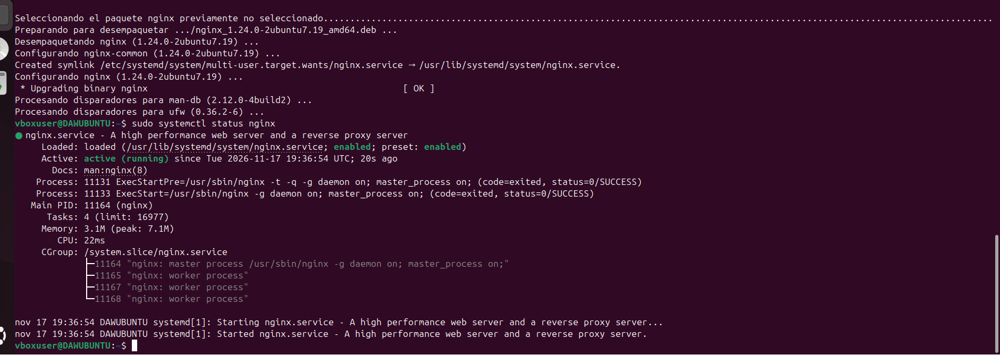
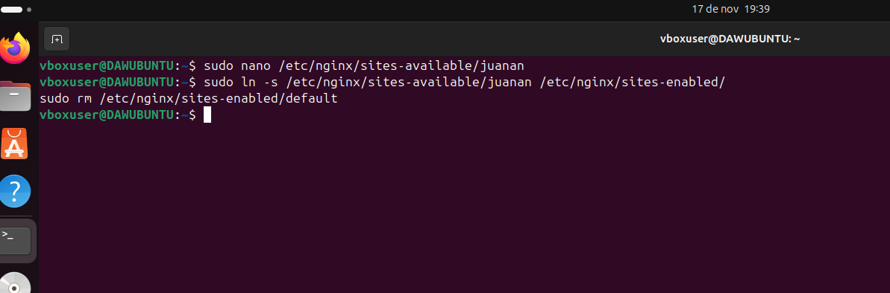
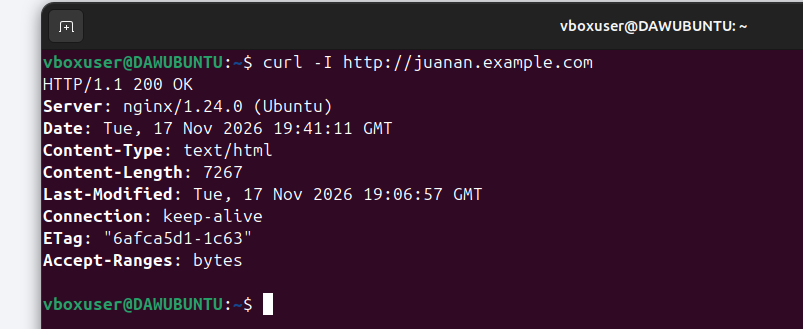

# Instalación y configuración de un servidor web Nginx en Ubuntu

**Memoria de la práctica**

**Autor:** Juan Ángel
**Fecha:** noviembre de 2026
**Entorno:** Ubuntu 24.04 en una máquina virtual (VirtualBox, equipo `DAWUBUNTU`), Nginx 1.24.0

---

## Índice

1. [Introducción](#1-introducción)
2. [Investigación teórica](#2-investigación-teórica)
   1. [Qué es Nginx](#21-qué-es-nginx)
   2. [Diferencias principales con Apache](#22-diferencias-principales-con-apache)
   3. [Instalación y ejecución en Ubuntu](#23-instalación-y-ejecución-en-ubuntu)
3. [Implementación paso a paso](#3-implementación-paso-a-paso)
   1. [Instalación de Nginx](#31-instalación-de-nginx)
   2. [Configuración del servidor (bloque *server*)](#32-configuración-del-servidor-bloque-server)
   3. [Activación del sitio](#33-activación-del-sitio)
   4. [Validación y aplicación de cambios](#34-validación-y-aplicación-de-cambios)
4. [Verificación del acceso](#4-verificación-del-acceso)
5. [Conclusiones y dificultades](#5-conclusiones-y-dificultades)
6. [Bibliografía](#6-bibliografía)

---

## 1. Introducción

El objetivo de la práctica es investigar qué es el servidor web Nginx, compararlo con Apache y llevar a cabo su instalación en Ubuntu. En la parte práctica se instala el servicio, se crea un sitio propio mediante un bloque de servidor (el equivalente de un *VirtualHost* de Apache), se valida la configuración y se comprueba que el sitio responde correctamente.

---

## 2. Investigación teórica

### 2.1 Qué es Nginx

**Nginx** (se pronuncia «engine x») es un servidor web de código abierto que también funciona como **proxy inverso**, **balanceador de carga** y **proxy de correo** y de caché HTTP. Lo creó Igor Sysoev y se publicó en 2004. Nació para resolver el problema de atender miles de conexiones simultáneas con pocos recursos (el llamado *problema C10k*).

Su característica principal es su **arquitectura asíncrona y orientada a eventos**. Un proceso principal (*master*) lee la configuración y gestiona unos procesos de trabajo (*worker*). Cada *worker* atiende muchas conexiones a la vez dentro de un mismo bucle de eventos, sin crear un proceso o un hilo por cada una. Por eso consume poca memoria y escala bien con mucho tráfico.

Usos habituales:

- Servir contenido estático (HTML, CSS, JavaScript, imágenes) con mucha eficiencia.
- Actuar como proxy inverso delante de aplicaciones (Node.js, Python, Java, PHP-FPM…).
- Repartir el tráfico entre varios servidores (balanceo de carga).
- Terminar conexiones HTTPS/TLS.

### 2.2 Diferencias principales con Apache

| Aspecto | Nginx | Apache HTTP Server |
|---|---|---|
| **Arquitectura** | Asíncrona y orientada a eventos: pocos procesos *worker*, cada uno atiende muchas conexiones | Basada en procesos o hilos mediante módulos MPM (`prefork`, `worker`, `event`) |
| **Consumo de recursos** | Bajo y predecible, incluso con muchas conexiones | Mayor con mucha concurrencia, sobre todo con `prefork` |
| **Contenido estático** | Muy rápido y eficiente | Correcto, pero habitualmente más pesado |
| **Contenido dinámico** | No lo procesa por sí mismo: lo delega a un servicio externo (FastCGI/PHP-FPM, `proxy_pass`) | Puede procesarlo con módulos integrados (como `mod_php`) o delegarlo |
| **Configuración por directorio** | No admite `.htaccess`; todo se define en los archivos de configuración | Admite `.htaccess`, que permite cambiar la configuración sin reiniciar, a costa de rendimiento |
| **Sitios virtuales** | Bloques `server { … }` | Bloques `<VirtualHost>` |
| **Módulos** | Tradicionalmente se compilaban con el programa; hoy también admite módulos dinámicos | Carga dinámica de módulos muy flexible y con un ecosistema amplio |
| **Uso típico** | Proxy inverso, balanceo, sitios con mucho tráfico estático | Alojamiento compartido, aplicaciones que dependen de `.htaccess` |
| **Licencia** | Licencia BSD de 2 cláusulas | Licencia Apache 2.0 |

Ninguno es «mejor» en general. Apache destaca por su flexibilidad y compatibilidad, y Nginx por su rendimiento y su bajo consumo. En muchas instalaciones se combinan: Nginx delante, como proxy inverso, y Apache detrás.

### 2.3 Instalación y ejecución en Ubuntu

Nginx está en los repositorios oficiales de Ubuntu, de modo que se instala con `apt`:

```bash
sudo apt update
sudo apt install nginx
```

El paquete deja el servicio gestionado por **systemd**, y se arranca y se habilita para el inicio automático. Los comandos habituales son:

```bash
sudo systemctl status nginx    # ver el estado
sudo systemctl start nginx     # arrancar
sudo systemctl stop nginx      # parar
sudo systemctl restart nginx   # reiniciar (corta las conexiones)
sudo systemctl reload nginx    # recargar la configuración sin cortar conexiones
sudo nginx -t                  # comprobar la sintaxis de la configuración
```

Estructura de archivos en Ubuntu (paquete de Debian/Ubuntu):

| Ruta | Función |
|---|---|
| `/etc/nginx/nginx.conf` | Configuración principal |
| `/etc/nginx/sites-available/` | Archivos de configuración de cada sitio (disponibles) |
| `/etc/nginx/sites-enabled/` | Enlaces simbólicos a los sitios activos |
| `/var/www/html` | Directorio raíz del sitio por defecto |
| `/var/log/nginx/` | Registros `access.log` y `error.log` |

La configuración principal incluye todo lo que haya en `sites-enabled/`. Para activar un sitio se crea un enlace simbólico desde `sites-available/`, y para desactivarlo se elimina ese enlace sin borrar el archivo original.

---

## 3. Implementación paso a paso

### 3.1 Instalación de Nginx

Se instaló el paquete con `apt` (`sudo apt install nginx`). La instalación descargó la versión `1.24.0-2ubuntu7.19` y creó el enlace de systemd para que el servicio se inicie con el sistema. Después se comprobó su estado:

```bash
sudo systemctl status nginx
```



*Figura 1. Instalación del paquete y estado del servicio.*

En la salida se ve que:

- El servicio aparece como **`active (running)`**.
- Está **`enabled`**, es decir, arranca automáticamente con el sistema.
- Hay un proceso *master* y tres procesos *worker*, como describe la arquitectura de la sección 2.1.

### 3.2 Configuración del servidor (bloque *server*)

En Nginx cada sitio virtual se define en un bloque `server`, el equivalente de `<VirtualHost>` en Apache. Se creó un archivo propio en `sites-available`:

```bash
sudo nano /etc/nginx/sites-available/juanan
```

Contenido del archivo:

```nginx
server {
    listen 80;
    listen [::]:80;

    server_name juanan.example.com;

    root /var/www/juanan;
    index index.html index.htm;

    location / {
        try_files $uri $uri/ =404;
    }
}
```


*Figura 2. Archivo `/etc/nginx/sites-available/juanan` abierto en nano.*

Significado de cada directiva:

| Directiva | Función |
|---|---|
| `listen 80;` | Escucha las peticiones HTTP por el puerto 80 en IPv4 |
| `listen [::]:80;` | Lo mismo para IPv6 |
| `server_name juanan.example.com;` | Nombre de dominio al que responde este bloque. Nginx lo compara con la cabecera `Host` de la petición para elegir el sitio |
| `root /var/www/juanan;` | Directorio del que se leen los archivos del sitio |
| `index index.html index.htm;` | Archivos que se sirven al pedir un directorio, en orden de preferencia |
| `location / { … }` | Reglas para todas las rutas del sitio |
| `try_files $uri $uri/ =404;` | Busca primero un archivo con esa ruta, después un directorio, y si no existe ninguno devuelve el error 404 |

### 3.3 Activación del sitio

Un sitio de `sites-available` no se sirve hasta que está enlazado en `sites-enabled`. Se creó el enlace simbólico y se eliminó el sitio por defecto, para que no interfiriera con el nuevo:

```bash
sudo ln -s /etc/nginx/sites-available/juanan /etc/nginx/sites-enabled/
sudo rm /etc/nginx/sites-enabled/default
```



*Figura 3. Creación del enlace simbólico y eliminación del sitio por defecto.*

Al borrar solo el enlace de `sites-enabled/default`, el archivo original sigue en `sites-available/`, por lo que se puede volver a activar cuando haga falta.

### 3.4 Validación y aplicación de cambios

Antes de aplicar los cambios se comprueba que la configuración no tiene errores de sintaxis, y después se recarga el servicio. La recarga (`reload`) aplica la nueva configuración sin cortar las conexiones que ya están abiertas, a diferencia de `restart`:

```bash
sudo nginx -t
sudo systemctl reload nginx
```

Si la comprobación es correcta, `nginx -t` indica que la sintaxis es válida (`syntax is ok`) y que la prueba de configuración ha sido satisfactoria (`test is successful`). Si hay un error, informa del archivo y la línea, y no se debe recargar hasta corregirlo.

Como `juanan.example.com` no es un dominio real, el equipo tiene que saber a qué dirección corresponde. Para ello se asocia el nombre a la dirección local en el archivo `/etc/hosts`:

```
127.0.0.1   juanan.example.com
```

---

## 4. Verificación del acceso

Para comprobar que el sitio responde a través de Nginx se hizo una petición con `curl`, que solicita solo las cabeceras (`-I`):

```bash
curl -I http://juanan.example.com
```



*Figura 4. Respuesta del servidor a la petición con `curl -I`.*

Qué demuestra la respuesta:

- **`HTTP/1.1 200 OK`**: la petición se atendió correctamente.
- **`Server: nginx/1.24.0 (Ubuntu)`**: quien responde es Nginx, en la versión instalada.
- **`Content-Type: text/html`** y **`Content-Length: 7267`**: se sirve una página HTML del directorio configurado.
- **`Last-Modified`** y **`ETag`**: datos que Nginx obtiene del archivo y que usan los navegadores para la caché.

Esto confirma que el bloque `server` está activo y que el nombre `juanan.example.com` se asocia al sitio configurado.

---

## 5. Conclusiones y dificultades

**Conclusiones**

- Nginx se instala en Ubuntu en pocos comandos y queda funcionando como servicio desde el primer momento.
- El esquema `sites-available` / `sites-enabled` separa lo que está definido de lo que está activo. Permite activar y desactivar sitios con un simple enlace simbólico, sin perder la configuración.
- El bloque `server` de Nginx cumple la misma función que el `VirtualHost` de Apache, con una sintaxis más corta y directa.
- Validar con `nginx -t` antes de recargar evita dejar el servidor caído por un error de escritura, y `reload` permite aplicar cambios sin cortar a los usuarios.
- La arquitectura por eventos explica por qué Nginx se usa tanto como servidor de contenido estático y como proxy inverso.

**Dificultades encontradas**

- **Nombre de dominio de prueba.** Al no ser `example.com` un dominio real, hay que asociarlo a la dirección local en `/etc/hosts` para poder probar el sitio por nombre.
- **Sitio por defecto.** El paquete trae activo un sitio por defecto que escucha en el mismo puerto. Hay que desactivarlo (borrando su enlace) o distinguir los sitios por `server_name` para evitar confusiones sobre cuál responde.
- **Permisos y rutas.** El directorio de `root` debe existir y ser legible por el usuario con el que se ejecuta Nginx. Si no, el servidor devuelve errores 403 o 404.
- **Sintaxis estricta.** Cada directiva termina en punto y coma y las llaves deben cerrarse. Un fallo impide aplicar la configuración, y por eso es útil `nginx -t`.

---

## 6. Bibliografía

- Nginx. *Documentación oficial*. https://nginx.org/en/docs/
- Nginx. *Beginner's Guide*. https://nginx.org/en/docs/beginners_guide.html
- Apache Software Foundation. *Apache HTTP Server Documentation, versión 2.4*. https://httpd.apache.org/docs/2.4/
- Ubuntu. *Ubuntu Server documentation*. https://ubuntu.com/server/docs
